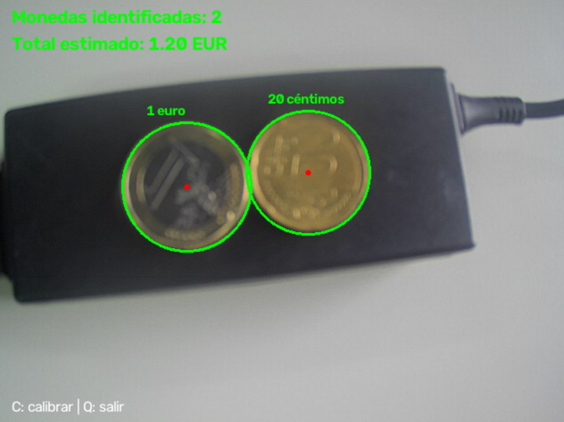

# 👁️ Práctica 3 — Visión por Computador

> **Universidad de Las Palmas de Gran Canaria (ULPGC)**  
> **Escuela de Ingeniería en Informática** — Grado en Ingeniería Informática  
> **Asignatura:** Visión por Computador  
> **Autores:** Aridane Miranda Domínguez y Erick Justo Sosa

---

## 📂 Estructura de la práctica

```
P3/
├── VC_P3.ipynb          # Notebook principal (tareas + demostradores)
├── Monedas.jpg           # Imagen ideal para el clasificador de monedas
├── MPs_test.jpg          # Imagen de test para microplásticos
├── MPs_test_bbs.csv      # Anotaciones (bounding boxes y etiquetas) del test
├── FRA.png / PEL.png / TAR.png   # Imágenes de referencia por clase
├── demostrador_vivo.png  # Captura del demostrador en vivo
└── README.md
```

---

## 1️⃣ Tarea 1: Clasificador de monedas (imagen ideal)

**Propósito:** detectar y clasificar monedas euro en una imagen estática, calculando el total de dinero presente.

**Técnica:**
- Conversión a gris + suavizado Gaussiano.
- Detección de círculos con la **Transformada de Hough** (`cv2.HoughCircles`).
- Refinamiento por mínimos cuadrados sobre los bordes de Canny.
- Eliminación de duplicados por distancia entre centros.
- **Calibración interactiva**: el usuario selecciona dos extremos opuestos de una moneda de 1 € para establecer la relación píxeles/mm (diámetro oficial 23.25 mm).
- Clasificación por diámetro (distancia mínima a los diámetros oficiales de cada moneda).

**Resultado:** detección de 8 monedas y total de **3.88 €** en la imagen ideal.


---

## 2️⃣ Tarea 2: Demostrador en vivo (cámara)

**Propósito:** determinar el dinero presente en la escena a partir del vídeo de la cámara web, en tiempo real.

**Técnica:** mismo pipeline que la Tarea 1 (Hough + calibración por clics sobre una moneda de 1 €), adaptado a fotogramas en vivo. Se aplica una tolerancia de ±1.2 mm al diámetro para marcar como "no identificada" las detecciones dudosas.

**Controles:** `C` para calibrar, `Q` para salir.



---

## 3️⃣ Tarea 3: Clasificador de microplásticos (SMACC)

**Propósito:** clasificar partículas en tres clases — **FRA** (fragmentos), **PEL** (pellets) y **TAR** (alquitrán) — usando únicamente heurísticas geométricas (sin deep learning), evaluando con la imagen de test anotada.

**Técnica:**
- Segmentación por umbralización de Otsu sobre recortes de cada partícula.
- Extracción de características geométricas (SMACC): compacidad, relación área/contenedor, relación ancho/alto, ratio de ejes de la elipse y relación de distancias al centroide.
- Clasificador nearest-centroid (distancia euclídea a un vector de referencia por clase).
- Evaluación sobre `MPs_test.jpg` con sus anotaciones `MPs_test_bbs.csv`: Accuracy, Precision, Recall, F1 y matriz de confusión.

**Resultados (solo geometría):**
- Accuracy = 0.4833
- Precision = 0.4927
- Recall = 0.4833
- F1 Score = 0.4640


---

## 🧪 Tarea extra: incorporación del color (apariencia)

Se añade la **media de los canales HSV** de cada partícula como característica de apariencia, combinándola con las geométricas, y se comparan las métricas y la matriz de confusión frente a usar solo geometría.

**Resultados:**
- Sin color → Acc=0.4833, F1=0.4640
- Con color → Acc=0.4833, F1=0.4647

La mejora es marginal: en este dataset (condiciones controladas) la geometría domina y el color no aporta de forma significativa, por lo que se documenta como resultado experimental.

---

## 📦 Requisitos

```bash
pip install opencv-python numpy matplotlib seaborn scikit-learn
```

Entorno recomendado: `VC_P1` (Python 3.11).

## 📝 Notas

- No se hace uso de modelos de aprendizaje profundo en ninguna tarea.
- La calibración de monedas se basa en el diámetro oficial de la moneda de 1 € (23.25 mm).
- Las anotaciones de `MPs_test_bbs.csv` pueden contener errores (es el mundo real).