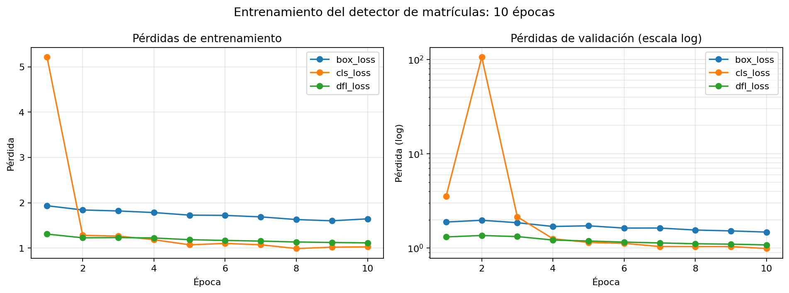
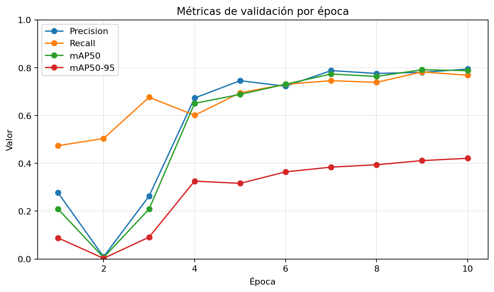
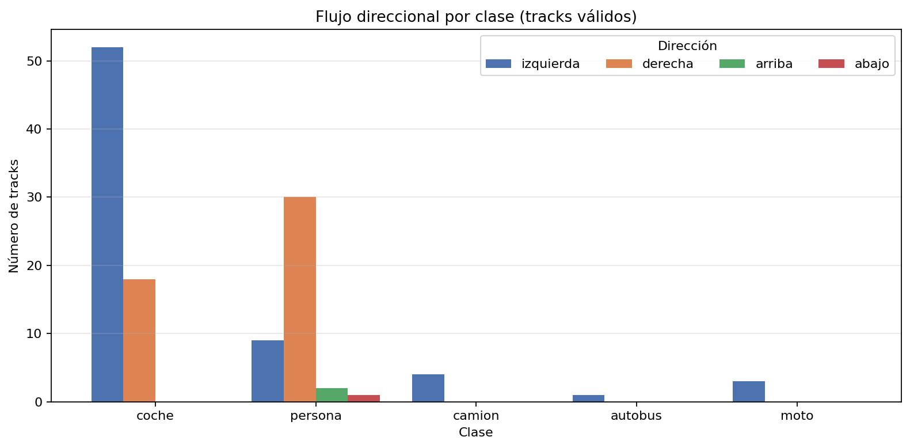

# 🚗 Práctica 4 — Detección de vehículos y matrículas (P4)

> **Universidad de Las Palmas de Gran Canaria (ULPGC)**  
> **Escuela de Ingeniería en Informática** — Grado en Ingeniería Informática  
> **Asignatura:** Visión por Computador  
> **Autores:** Aridane Miranda Domínguez y Erick Justo Sosa

---

## 📂 Estructura del proyecto

```text
P4/
├── best.pt                      # Detector de matrículas entrenado (YOLO11s)
├── detecciones.csv              # Detecciones, tracking y cajas de matrícula
├── training_results.csv         # Métricas y pérdidas de las 10 épocas
├── training_loss.png            # Evolución de las pérdidas
├── training_metrics.png         # Evolución de Precision, Recall y mAP
├── extras_faciles.py            # Genera anonimización y flujo direccional
├── load_rtdetr.py               # Carga y ejecución de RT-DETR
├── VC_P4_RTDETR.ipynb           # Notebook de la práctica
├── README.md                    # Documentación de P4
├── requirements.txt             # Dependencias de P4
│
├── video_tarea1.mp4             # Tarea 1: vehículos/personas y matrículas
├── video_tarea1_recorte.mp4     # Recorte de 10 s de la Tarea 1
├── video_anonimizado.mp4        # Extra: vídeo con personas/vehículos pixelados
├── flujo_direcciones.csv        # Extra: flujo por track
├── flujo_direcciones_resumen.csv # Extra: resumen por clase y dirección
├── flujo_direcciones.png        # Extra: gráfica del flujo direccional
├── test.jpg                     # Imagen de prueba para RT-DETR
└── yolo11s.pt                   # YOLO11 small (detección de vehículos)
```

> La parte OCR se entrega en la carpeta [`P4b/`](../P4b/README.md).
>
> `RT-DETR/` se clona automáticamente desde el notebook si la carpeta no existe.

---

## 🎯 Resumen de P4

P4 implementa el prototipo de **detección y seguimiento** sobre el vídeo de tráfico `C0142.MP4`:

- Detección de personas y vehículos con YOLO11.
- Seguimiento con **ByteTrack** e identificadores únicos.
- Localización de matrículas con el detector `best.pt`.
- Recuento de objetos únicos por clase.
- Vídeo anotado y CSV de resultados.

**No se realiza OCR en P4.** La columna `texto_matricula` se deja vacía y el reconocimiento de caracteres corresponde a P4b.

**Extras implementados:** anonimización de personas/vehículos y flujo direccional por clase.

**Resultado de la ejecución:**

- 2.832 fotogramas procesados.
- 29.335 filas en `detecciones.csv`.
- 382 identificadores de seguimiento distintos (415 asignaciones clase-ID; 29 IDs aparecen en más de una clase).
- 1.431 matrículas localizadas en 1.195 fotogramas.
- Vídeo de salida: 1280 × 720, 25 fps, 1:53,28.

---

## 1️⃣ Tarea 1: Detección y seguimiento de vehículos y personas

**Propósito:** detectar y seguir personas y vehículos a lo largo del vídeo, manteniendo un identificador único para cada objeto y localizando su matrícula cuando sea visible.

**Técnica:**

- Detección de objetos mediante `yolo11s.pt`.
- Clases consideradas: persona, coche, motocicleta, autobús y camión.
- Seguimiento mediante **ByteTrack** (`bytetrack.yaml`).
- Asignación de identificadores de seguimiento (*tracking IDs*).
- Localización de matrículas con `best.pt` dentro de cada vehículo.
- Recuento de objetos únicos por clase.
- Generación de un vídeo anotado y un CSV.

**Resultado:** vídeo con cajas de detección, identificadores de seguimiento, matrículas localizadas (caja azul, sin OCR) y contador de objetos por clase.

**Demostración:**

[🎬 Ver recorte de la Tarea 1](./video_tarea1_recorte.mp4) · [Vídeo completo](./video_tarea1.mp4)

### Recuento de objetos únicos

| Clase | Identificadores únicos |
|---|---:|
| Coche | 273 |
| Persona | 91 |
| Camión | 37 |
| Autobús | 9 |
| Moto | 5 |
| **Suma por clase** | **415** |

> Hay 382 IDs distintos en total. La diferencia (415 − 382 = 33 asignaciones extra) se debe a que 29 identificadores aparecen asociados a más de una clase a lo largo del vídeo. Es un comportamiento del tracker, no un error del CSV.

### CSV de resultados

El archivo [`detecciones.csv`](./detecciones.csv) contiene 29.335 filas y las siguientes columnas:

```text
fotograma, tipo_objeto, confianza, identificador_tracking,
x1, y1, x2, y2,
matricula_en_su_caso, confianza_matricula,
mx1, my1, mx2, my2, texto_matricula
```

- `matricula_en_su_caso`: 1 si el vehículo tiene matrícula localizada, 0 en caso contrario.
- `confianza_matricula`: confianza del detector de matrículas.
- `mx1, my1, mx2, my2`: coordenadas absolutas de la matrícula en el fotograma.
- `texto_matricula`: vacío en P4; se rellena en P4b.

> **Nota:** este script localiza las matrículas, pero no reconoce sus caracteres. El reconocimiento del texto se realiza en la Tarea 2 (P4b).

---

## 2️⃣ Preparación del conjunto de datos

**Propósito:** preparar las imágenes y anotaciones de matrículas para entrenar un detector personalizado mediante YOLO.

**Dataset:** [`prac4VC_dataset`](https://drive.google.com/drive/folders/1RFd6sKH_QMQcpE_w5rWmy8rKiYUY5_SI)

**Técnica:**

- Lectura de imágenes y anotaciones originales en formato JSON.
- Extracción de las coordenadas de las matrículas.
- Conversión de las cajas delimitadoras al formato YOLO.
- Normalización de las coordenadas respecto al tamaño de cada imagen.
- Generación de archivos `.txt` asociados a cada imagen.
- Organización del dataset para entrenamiento.

**Formato YOLO utilizado:**

```text
<object-class-id> <x_centro> <y_centro> <ancho> <alto>
```

Las coordenadas están normalizadas respecto al ancho y alto de la imagen.

**Resultado:** conjunto de datos estructurado y compatible con Ultralytics YOLO.

> **Limitación documentada:** el `data.yaml` del notebook usa `train: images` y `val: images`. No se creó una partición independiente de validación/test. Por tanto, las métricas del apartado siguiente se calculan sobre las mismas imágenes usadas en entrenamiento y deben interpretarse como una comprobación de ajuste, no como una validación independiente.

---

## 3️⃣ Entrenamiento del detector de matrículas

**Propósito:** entrenar un modelo YOLO capaz de localizar matrículas en imágenes y vídeos.

**Configuración del entrenamiento:**

| Parámetro | Valor |
|---|---|
| Modelo base | `yolo11s.pt` |
| Tamaño de imagen | 640 |
| Batch | 16 |
| Épocas configuradas | 30 |
| Épocas completadas en `best.pt` | 10 |
| Dispositivo | GPU (Google Colab) |
| Dataset | [`prac4VC_dataset`](https://drive.google.com/drive/folders/1RFd6sKH_QMQcpE_w5rWmy8rKiYUY5_SI) |
| `train` / `val` | `images` / `images` |

> El notebook configura 30 épocas, pero el checkpoint `best.pt` que se conserva contiene **10 épocas**. Las curvas y métricas de este README corresponden a esas 10 épocas.

### Evolución de las pérdidas



La pérdida de clasificación de validación tiene un pico anómalo en la época 2 (≈105,57), por eso el panel de validación se muestra en escala logarítmica. A partir de la época 4 se estabiliza alrededor de 1,0.

### Evolución de las métricas



### Análisis del entrenamiento

- **Época 1:** mAP50 = 0,209 y mAP50-95 = 0,088. El modelo todavía está muy lejos de converger.
- **Época 2:** inestabilidad fuerte; la pérdida de clasificación de validación sube a 105,57 y mAP50 cae a 0,006.
- **Época 4:** mejora clara; mAP50 = 0,651 y mAP50-95 = 0,325.
- **Época 10:** Precision = 0,794, Recall = 0,768, mAP50 = 0,787 y mAP50-95 = 0,421. Es el mejor checkpoint de la ejecución (`best_fitness = 0,421`).

Las pérdidas de entrenamiento descienden de forma sostenida: `box_loss` pasa de 1,934 a 1,644, `cls_loss` de 5,212 a 1,026 y `dfl_loss` de 1,308 a 1,115. En validación, `box_loss` baja de 1,890 a 1,478 y `dfl_loss` de 1,314 a 1,081. La pérdida de clasificación de validación, tras el pico de la época 2, termina en 0,990.

### Métricas finales del checkpoint

| Métrica | Valor |
|---|---:|
| Precision | 0,79394 |
| Recall | 0,76797 |
| mAP50 | 0,78740 |
| mAP50-95 | 0,42086 |
| `best_fitness` | 0,42086 |

Los datos completos están en [`training_results.csv`](./training_results.csv).

> **Limitación:** al usar `val: images` igual que `train: images`, estas métricas no son una validación independiente. Para una evaluación rigurosa habría que separar train/val/test y reentrenar.

---

## 4️⃣ Extras implementados

Se han implementado dos extras reutilizando `detecciones.csv` y `video_tarea1.mp4`, **sin reentrenar ni repetir la inferencia**:

1. Anonimización de personas y vehículos.
2. Flujo direccional por clase.

El script [`extras_faciles.py`](./extras_faciles.py) genera todos los resultados de esta sección.

### 4.1 Anonimización

- Se recorre el vídeo fotograma a fotograma.
- Para cada caja de persona o vehículo del CSV se aplica pixelado.
- Se añade la etiqueta `ANONIMIZADO` en la esquina superior izquierda.
- Salida: [`video_anonimizado.mp4`](./video_anonimizado.mp4).
- Resultado: 2.832 fotogramas, 1280 × 720, 25 fps, 29.335 cajas pixeladas.

> El vídeo conserva las cajas y los contadores originales, pero las regiones correspondientes a personas y vehículos están pixeladas.

### 4.2 Flujo direccional

Para cada track se calcula el centro de la primera y de la última detección:

- `dx = x_final − x_inicial`
- `dy = y_final − y_inicial`

La dirección se clasifica como:

- **izquierda/derecha** si `|dx| ≥ |dy|`;
- **arriba/abajo** en caso contrario.

Se consideran **tracks válidos** aquellos con al menos **5 detecciones** y un desplazamiento mínimo de **20 píxeles**. Así se evitan tracks de pocos fotogramas o movimientos por ruido.

**Resultados:**

| Clase | Izquierda | Derecha | Arriba | Abajo | Válidos | Descartados |
|---|---:|---:|---:|---:|---:|---:|
| Coche | 52 | 18 | 0 | 0 | 70 | 188 |
| Persona | 9 | 30 | 2 | 1 | 42 | 37 |
| Camión | 4 | 0 | 0 | 0 | 4 | 20 |
| Autobús | 1 | 0 | 0 | 0 | 1 | 7 |
| Moto | 3 | 0 | 0 | 0 | 3 | 1 |
| **Total** | **69** | **48** | **2** | **1** | **120** | **253** |

- Asignaciones clase-ID totales: 415.
- Tracks con al menos 2 detecciones (analizables): 373.
- Tracks válidos: 120.
- Tracks descartados: 253.

**Salidas:**

- [`flujo_direcciones.csv`](./flujo_direcciones.csv): una fila por track, con desplazamiento y dirección.
- [`flujo_direcciones_resumen.csv`](./flujo_direcciones_resumen.csv): resumen por clase y dirección.
- [`flujo_direcciones.png`](./flujo_direcciones.png): gráfica comparativa.



> **Limitación:** los tracks que no cruzan la imagen, los que se pierden por oclusión o los que cambian de ID no siempre reflejan la dirección real. Por eso se descartan los tracks con pocas detecciones o poco desplazamiento.

---

## 5️⃣ RT-DETR

El notebook incluye ejemplos de RT-DETR y el módulo [`load_rtdetr.py`](./load_rtdetr.py), que permite cargar las familias v1 y v2 en distintos tamaños.

- `load_rtdetr.py` descarga los pesos oficiales y construye el modelo y el postprocesador.
- `test.jpg` se usa como imagen de prueba.
- RT-DETR **no** se usa para generar `detecciones.csv` ni el vídeo final; el detector final de matrículas es YOLO11s (`best.pt`).

> La comparativa YOLO vs RT-DETR para detección de matrículas es un extra del enunciado y no forma parte de la entrega base.

---

## 6️⃣ Cómo ejecutar

```bash
conda create --name VC_P4 python=3.9.5
conda activate VC_P4
pip install -r requirements.txt
```

Después, abrir [`VC_P4_RTDETR.ipynb`](./VC_P4_RTDETR.ipynb) y ejecutar las celdas de la Tarea 1. El notebook espera el vídeo `C0142.MP4` y los modelos `yolo11s.pt` y `best.pt` en la carpeta de trabajo.

El vídeo de entrada no se incluye en el repositorio por tamaño; se utilizó el vídeo proporcionado para la práctica.

Para regenerar la anonimización y el flujo direccional:

```bash
python extras_faciles.py
```

El script lee `detecciones.csv` y `video_tarea1.mp4`, y genera `video_anonimizado.mp4`, `flujo_direcciones.csv`, `flujo_direcciones_resumen.csv` y `flujo_direcciones.png`.

Para la parte OCR, consultar [`../P4b/README.md`](../P4b/README.md).

---

## 7️⃣ Entregables de P4

- [`README.md`](./README.md)
- [`VC_P4_RTDETR.ipynb`](./VC_P4_RTDETR.ipynb)
- [`video_tarea1.mp4`](./video_tarea1.mp4)
- [`detecciones.csv`](./detecciones.csv)
- [`best.pt`](./best.pt)
- [`training_loss.png`](./training_loss.png), [`training_metrics.png`](./training_metrics.png) y [`training_results.csv`](./training_results.csv)
- [`extras_faciles.py`](./extras_faciles.py)
- [`video_anonimizado.mp4`](./video_anonimizado.mp4)
- [`flujo_direcciones.csv`](./flujo_direcciones.csv), [`flujo_direcciones_resumen.csv`](./flujo_direcciones_resumen.csv) y [`flujo_direcciones.png`](./flujo_direcciones.png)
- Dataset: [`prac4VC_dataset`](https://drive.google.com/drive/folders/1RFd6sKH_QMQcpE_w5rWmy8rKiYUY5_SI)
- Parte OCR: [`P4b/`](../P4b/README.md)

---

## 8️⃣ Limitaciones y trabajo futuro

- El entrenamiento no tiene una partición independiente de validación/test.
- El checkpoint conserva 10 épocas aunque el notebook configure 30.
- Se implementan los extras de anonimización y flujo direccional.
- Quedan pendientes la comparativa YOLO/RT-DETR y la detección por contornos.
- La parte OCR se documenta en P4b y sus CSV se generan ejecutando el notebook en Colab.

---

## 9️⃣ Librerías principales

```bash
pip install ultralytics
pip install opencv-python
pip install pandas
pip install numpy
pip install matplotlib
pip install lap
```

Para RT-DETR, además:

```bash
pip install tensorboard
pip install faster_coco_eval
```

Para el uso de GPU es necesario disponer de una instalación compatible de CUDA y PyTorch.
