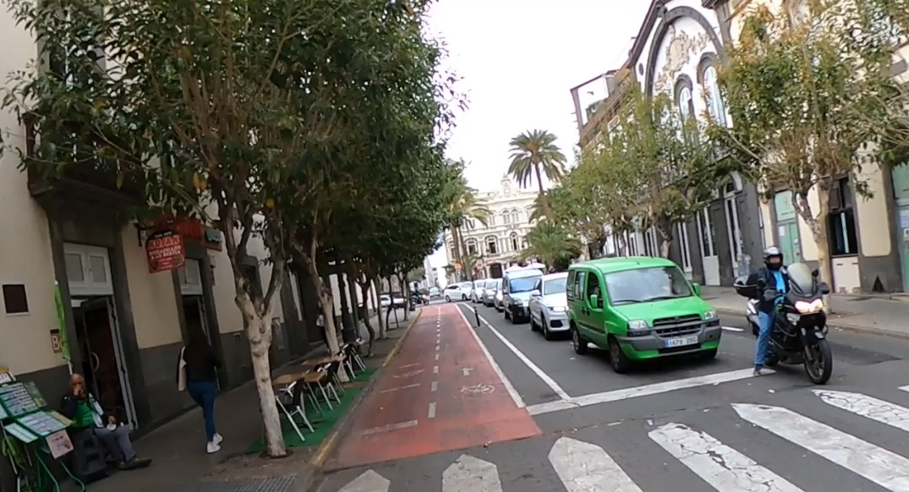

# 🚗 Práctica 4 — Detección de vehículos y matrículas

> **Universidad de Las Palmas de Gran Canaria (ULPGC)**  
> **Escuela de Ingeniería en Informática** — Grado en Ingeniería Informática  
> **Asignatura:** Visión por Computador  
> **Autores:** Aridane Miranda Domínguez y Erick Justo Sosa

---

## 📂 Estructura de la práctica

## 📂 Estructura del proyecto

```text
P4/
├── RT-DETR/                  # Archivos relacionados con el modelo RT-DETR
├── runs/                     # Resultados de entrenamientos y ejecuciones
├── weights/                  # Pesos de los modelos entrenados
│
├── detecciones.csv           # Resultados de detección y seguimiento
├── load_rtdetr.py            # Carga y ejecución del modelo RT-DETR
├── README.md                 # Documentación de la práctica
├── requirements.txt          # Dependencias del proyecto
│
├── test.jpg                  # Imagen de prueba
├── VC_P4_RTDETR.ipynb        # Notebook de experimentación con RT-DETR
│
├── video_resultado_ocr.mp4   # Vídeo procesado con detección y OCR
├── VIDEOAPROBAR.mp4          # Vídeo de prueba
│
├── yolo11n-pose.pt            # Modelo YOLO11 para estimación de pose
├── yolo11n-seg.pt             # Modelo YOLO11 para segmentación
├── yolo11n.pt                 # Modelo YOLO11 nano
├── yolo11s.pt                 # Modelo YOLO11 small
│
└── .gitignore                # Archivos excluidos del repositorio
```

---

# 4️⃣ Tarea 1: Detección y seguimiento de vehículos y personas

**Propósito:** detectar y realizar el seguimiento de personas y vehículos a lo largo de un vídeo, manteniendo un identificador único para cada objeto.

**Técnica:**

- Detección de objetos mediante YOLO11 preentrenado.
- Identificación de las clases persona, coche, motocicleta, autobús y camión.
- Seguimiento de los objetos mediante **ByteTrack**.
- Asignación de identificadores de seguimiento (*tracking IDs*).
- Aplicación de un segundo modelo YOLO para localizar las matrículas en los vehículos.
- Recuento de objetos únicos detectados por clase.
- Generación de un vídeo anotado y un archivo CSV.

**Resultado:** vídeo con las cajas de detección, identificadores de seguimiento, matrículas localizadas y contador de objetos por clase.

**Demostración:**


[🎬 Ver vídeo de detección y OCR](./video_resultado_ocr.mp4)

**Datos exportados:** el CSV incluye información del fotograma, tipo de objeto, confianza, identificador de seguimiento, coordenadas de la detección y datos de la matrícula cuando está disponible.

> **Nota:** este script localiza las matrículas, pero no reconoce sus caracteres. El reconocimiento del texto se realiza mediante el sistema OCR de la tarea anterior.

---


# 1️⃣ Preparación del conjunto de datos

**Propósito:** preparar las imágenes y anotaciones de matrículas para entrenar un detector personalizado mediante YOLO.

**Técnica:**

- Lectura de imágenes y anotaciones originales en formato JSON.
- Extracción de las coordenadas de las matrículas.
- Conversión de las cajas delimitadoras al formato YOLO.
- Normalización de las coordenadas respecto al tamaño de cada imagen.
- Generación de archivos `.txt` asociados a cada imagen.
- Organización del dataset para entrenamiento, validación y test.

**Resultado:** conjunto de datos estructurado y compatible con Ultralytics YOLO.

[Visualización del conjunto de datos](./P4a/imagenes/dataset_ejemplo.jpg)

---

# 2️⃣ Entrenamiento del detector de matrículas

**Propósito:** entrenar un modelo YOLO capaz de localizar matrículas en imágenes y vídeos.

**Técnica:**

- Utilización de YOLO11 como modelo de partida.
- Entrenamiento personalizado con las imágenes anotadas.
- Configuración del tamaño de imagen, batch y número de épocas.
- Validación del modelo durante el entrenamiento.
- Selección de los mejores pesos generados (`best.pt`).

**Evaluación:** se analizan las métricas Precision, Recall, mAP50 y mAP50-95, junto con la evolución de las funciones de pérdida.

---

# 3️⃣ Tarea 2: Detección de matrículas y reconocimiento OCR

**Propósito:** detectar las matrículas presentes en un vídeo y reconocer automáticamente los caracteres que contienen.

**Técnica:**

- Lectura del vídeo fotograma a fotograma.
- Detección de matrículas mediante el modelo YOLO entrenado.
- Recorte de las regiones correspondientes a cada matrícula.
- Reconocimiento de caracteres mediante PaddleOCR.
- Dibujado de las cajas delimitadoras y del texto reconocido.
- Exportación de los resultados a un archivo CSV.

**Resultado:** vídeo anotado con las matrículas detectadas y el texto reconocido, junto con un CSV que almacena los resultados.

**Demostración:**


[](./video_resultado_ocr.mp4)

---


# 5️⃣ Tarea 2.2: Comparación entre OCR clásico y VLM

**Propósito:** comparar dos enfoques de reconocimiento de matrículas: un OCR tradicional basado en redes neuronales y un modelo de lenguaje visual.

**Modelos utilizados:**

- **PaddleOCR:** sistema especializado en reconocimiento óptico de caracteres.
- **SmolVLM:** modelo de lenguaje visual capaz de interpretar imágenes y extraer información textual.

**Técnica:**

- Evaluación de ambos modelos sobre las mismas imágenes de matrículas.
- Obtención del texto reconocido por cada modelo.
- Comparación de las predicciones con el texto real.
- Cálculo de la tasa de acierto (*Accuracy*).
- Cálculo del error a nivel de carácter (CER).
- Medición del tiempo de inferencia.
- Generación de archivos CSV y gráficas comparativas.

**Resultados:**

| Modelo | Accuracy | CER | Tiempo medio |
|---|---:|---:|---:|
| PaddleOCR | [Completar] | [Completar] | [Completar] |
| SmolVLM | [Completar] | [Completar] | [Completar] |

**Comparación de resultados:**


**Conclusiones:** [Completar con el análisis de las métricas obtenidas, indicando qué modelo ofrece mayor precisión y cuál presenta menor tiempo de inferencia.]

---

# 🎬 Resultado final de la práctica

El sistema desarrollado integra detección, seguimiento y reconocimiento de matrículas para procesar vídeos de tráfico.

El resultado final permite:

- Detectar personas y vehículos.
- Seguir los objetos mediante identificadores únicos.
- Localizar las matrículas de los vehículos.
- Reconocer los caracteres de las matrículas.
- Contabilizar los objetos detectados por clase.
- Generar vídeos anotados con los resultados.
- Exportar las detecciones y reconocimientos a archivos CSV.


---


Principales librerías utilizadas:

```bash
pip install ultralytics
pip install opencv-python
pip install pandas
pip install lap
pip install paddleocr
pip install transformers
```

Para el uso de GPU es necesario disponer de una instalación compatible de CUDA y PyTorch.

---

