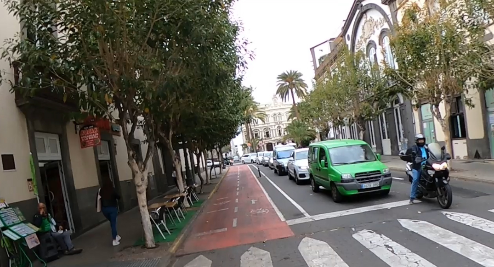

# 🔎 Práctica 4b — Reconocimiento OCR de matrículas

> **Universidad de Las Palmas de Gran Canaria (ULPGC)**  
> **Escuela de Ingeniería en Informática** — Grado en Ingeniería Informática  
> **Asignatura:** Visión por Computador  
> **Autores:** Aridane Miranda Domínguez y Erick Justo Sosa

---

## 📂 Estructura

```text
P4b/
├── README.md                    # Documentación de P4b
├── requirements.txt             # Dependencias de OCR
├── VideoOCRparaREADME.mp4       # Tarea 2: matrículas + OCR
├── test.jpg                     # Miniatura del vídeo
├── accuracy.png                 # Gráfica de accuracy (Tarea 2.2)
├── cer.png                      # Gráfica de CER (Tarea 2.2)
├── tiempos.png                  # Gráfica de tiempos (Tarea 2.2)
└── metricas_comparativa.csv     # Métricas agregadas de la comparativa
```

La parte de detección y seguimiento se entrega en [`../P4/`](../P4/README.md).

---

## 1️⃣ Tarea 2: Detección de matrículas y reconocimiento OCR

**Propósito:** detectar las matrículas presentes en un vídeo y reconocer automáticamente los caracteres que contienen.

**Técnica:**

- Lectura del vídeo fotograma a fotograma.
- Detección de matrículas con el modelo YOLO `best.pt` de P4.
- Recorte y ampliación de cada matrícula.
- Reconocimiento de caracteres con **PaddleOCR**.
- Dibujado de las cajas y del texto reconocido.
- Exportación de los resultados a un CSV.

**Resultado:** vídeo anotado con las matrículas detectadas y el texto reconocido.

**Demostración:**

[](./VideoOCRparaREADME.mp4)

El CSV de esta tarea (`matriculas_detectadas.csv`) se genera ejecutando la celda de vídeo del notebook [`../P4/VC_P4_RTDETR.ipynb`](../P4/VC_P4_RTDETR.ipynb) en Colab. No se incluye en el repositorio porque es un artefacto de ejecución.

---

## 2️⃣ Tarea 2.2: Comparación entre OCR clásico y VLM

**Propósito:** comparar dos enfoques de reconocimiento de matrículas: un OCR tradicional y un modelo de lenguaje visual.

**Modelos utilizados:**

- **PaddleOCR:** sistema especializado en reconocimiento óptico de caracteres.
- **SmolVLM:** modelo de lenguaje visual capaz de interpretar imágenes y extraer información textual.

**Técnica:**

- Evaluación de ambos modelos sobre las mismas imágenes de matrículas.
- Obtención del texto reconocido por cada modelo.
- Comparación de las predicciones con el texto real.
- Cálculo de la tasa de acierto (*Accuracy*).
- Cálculo del error a nivel de carácter (CER).
- Medición del tiempo de inferencia.
- Generación de archivos CSV y gráficas comparativas.

**Comparación de resultados:**

| Modelo | Accuracy | CER | Tiempo medio |
|---|---:|---:|---:|
| PaddleOCR | ≈45 % | ≈47 % | ≈5,2 s |
| SmolVLM | ≈70 % | ≈24 % | ≈4,2 s |


Los valores agregados están en [`metricas_comparativa.csv`](./metricas_comparativa.csv).

> El CSV por imagen (`comparativa_ocr_vlm.csv`) se genera ejecutando la celda de comparativa del notebook en Colab. No se incluye en el repositorio porque es un artefacto de ejecución.

---

## 3️⃣ Reproducción

```bash
pip install -r requirements.txt
```

Después, abrir [`../P4/VC_P4_RTDETR.ipynb`](../P4/VC_P4_RTDETR.ipynb) y ejecutar:

- la celda de **Tarea 2** para generar `matriculas_detectadas.csv` y el vídeo OCR;
- la celda de **Tarea 2.2** para generar `comparativa_ocr_vlm.csv` y las gráficas.

El notebook está preparado para Google Colab y monta Google Drive para acceder a `best.pt` y al dataset.

---

## 4️⃣ Limitaciones

- Los CSV de ejecución (`matriculas_detectadas.csv` y `comparativa_ocr_vlm.csv`) no se almacenan en el repositorio; se generan con el notebook.
- Las métricas de la comparativa son aproximadas y se obtuvieron sobre el conjunto de imágenes de matrículas de la práctica.
- No se incluye una comparativa YOLO vs RT-DETR para detección de matrículas; esa parte es un extra del enunciado y no forma parte de la entrega base.
